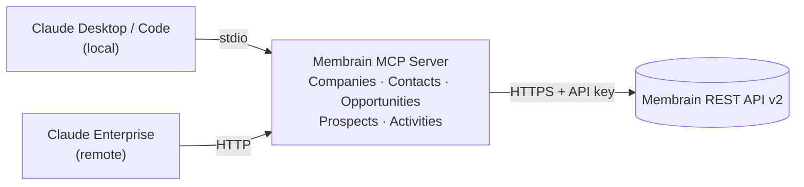

# Membrain MCP Server

An [MCP](https://modelcontextprotocol.io) server that exposes an **already deployed
Membrain CRM instance** to Claude, using Membrain's own
[REST API v2](https://www.membrain.com) (documentation supplied by Membrain; not
redistributed in this repository).

## Architecture

This server is a thin, typed adapter between Claude and Membrain's REST API. It holds
no CRM logic of its own: Membrain remains the sole source of truth, nothing is cached
or duplicated, and every tool call is a direct pass-through to a documented Membrain
endpoint.



The same server can run in three ways, depending on who needs access:

| Mode | Transport | Best for | Section |
|---|---|---|---|
| Local process | stdio | A single developer running it directly | [Setup](#setup) |
| Desktop Extension (`.mcpb`) | stdio | Any Team/Enterprise user, no local Python setup required | [Packaging as a Desktop Extension](#packaging-as-a-claude-desktop-extension-mcpb) |
| Container | HTTP | A shared, centrally hosted deployment | [Running as a container](#running-as-a-container) |

Destructive operations (`DELETE`, merge endpoints) are intentionally not exposed — see
[Extensibility](#extensibility-v2).

## Tools exposed (V1)

| Tool | Membrain endpoint | Notes |
|---|---|---|
| `list_users` | `GET /users/` | |
| `list_processes` | `GET /{sales,prospecting,accountGrowth,ticket,flow}Processes/` | `process_type` selects the endpoint |
| `list_custom_fields` | `GET /customFields/` | |
| `search_companies` | `GET /companies/` | paged |
| `get_company` | `GET /companies/{Id}` | |
| `create_company` | `POST /companies/` | |
| `update_company` | `PUT /companies/{Id}` | partial update |
| `search_contacts` | `GET /contacts/` | paged |
| `get_contact` | `GET /contacts/{Id}` | |
| `create_contact` | `POST /contacts/` | |
| `update_contact` | `PUT /contacts/{Id}` | partial update |
| `search_opportunities` | `GET /opportunities/` | paged |
| `get_opportunity` | `GET /opportunities/{Id}` | |
| `create_opportunity` | `POST /opportunities/` | |
| `update_opportunity` | `PUT /opportunities/{Id}` | partial update |
| `search_prospects` | `GET /prospects/` | paged, read-only in V1 |
| `get_prospect` | `GET /prospects/{Id}` | read-only in V1 |
| `create_note` | `POST /notes/` | additive, low risk |
| `create_task` | `POST /tasks/` | additive, low risk |

**Paging**: search tools return `{count, from, to, items}`. `to` is inclusive; when
`to == count` you're on the last page. Call the same search tool again with
`from_index` set to the previous `to` to fetch the next page. Membrain's own default
page size applies — no page-size parameter is exposed because none is documented in
Membrain's API documentation.

**Custom Fields**: any `create_*`/`update_*` tool accepts an optional
`custom_fields: {guid: value}` argument, which the server maps to Membrain's
`CustomField{GUID}` request keys for you. Discover available GUIDs via
`list_custom_fields` or `list_processes`.

## Setup

1. Install [uv](https://docs.astral.sh/uv/).
2. `uv sync --extra dev`
3. Copy `.env.example` to `.env` and fill in `MEMBRAIN_API_KEY` and `MEMBRAIN_BASE_URL`.
4. Run the server directly: `uv run python -m src.main`
   (or, if using the official `mcp` SDK for `stdio` testing: `uv run mcp dev src/main.py`).

### Registering with Claude Code

```bash
claude mcp add membrain -- uv run --directory /path/to/this/project python -m src.main
```

### Registering with Claude Desktop

Add to `claude_desktop_config.json`:

```json
{
  "mcpServers": {
    "membrain": {
      "command": "uv",
      "args": ["run", "--directory", "/path/to/this/project", "python", "-m", "src.main"],
      "env": { "MEMBRAIN_API_KEY": "your_api_key_here" }
    }
  }
}
```

## Packaging as a Claude Desktop Extension (.mcpb)

For users who shouldn't need Python/uv installed or a config file hand-edited, the
same server can be packaged as a [Desktop
Extension](https://claude.com/docs/connectors/custom/desktop-extensions) (`.mcpb`)
and installed like a normal app extension on Claude Desktop (Team/Enterprise plans).
Claude Desktop supplies its own `uv` runtime, and the Membrain API key is entered
through a secure install-time form instead of a plaintext file. This still runs one
local process per user — there's no shared audit trail across users.

The packaging sources (`manifest.json`, `run.py`, `.mcpbignore`) live in `mcpb/` in
this repo and are the source of truth for the extension's version and configuration.

```bash
npm install -g @anthropic-ai/mcpb   # one-time: official packaging CLI
./mcpb/build.sh                     # or mcpb/build.ps1 on Windows
```

Each run copies the current `src/`, `pyproject.toml`, `uv.lock` and `README.md` into a
sibling working folder (`../Membrain-mcp-dxt-prototype/` by default, kept outside this
repo), bumps the patch version in `mcpb/manifest.json`, and produces a fresh `.mcpb`
file there. Commit the version bump in `mcpb/manifest.json` after a successful build.

Distribute the resulting file either directly to a user, or — for a whole Claude
Enterprise organization — have an Owner upload it once via
`Organization Settings > Connectors > Desktop`.

**Known gotcha**: on Windows, Microsoft Defender's Attack Surface Reduction rule
"Block executable files from running unless they meet a prevalence, age, or trusted
list criterion" (GUID `01443614-cd74-433a-b99e-2ecdc07bfc25`) can block the
interpreter that `uv` creates inside the extracted extension folder, since it's a
freshly written, low-prevalence executable. If this happens, add a per-rule exclusion
(Intune: Endpoint security > Attack surface reduction > your ASR profile > enable
"ASR Only Per Rule Exclusions" on this rule) for
`C:\Users\*\AppData\Roaming\Claude\Claude Extensions\*`.

## Running as a container

The server defaults to stdio transport (local use). Set `MCP_TRANSPORT=http` to run
it as a standalone HTTP service instead (the Docker image below does this by
default), exposing a Streamable HTTP MCP endpoint on `/mcp` plus a liveness endpoint
at `/api/v1/internal/health`. That health check never calls Membrain — it's pure
process-liveness, so a Membrain outage never fails it — and always returns
`{"status":"OK","version":"...","dependencies":{}}`.

```bash
docker build -f .docker/Dockerfile -t membrain-mcp .
docker run --rm -p 8080:8080 -e MEMBRAIN_API_KEY=your_api_key_here membrain-mcp
curl http://localhost:8080/api/v1/internal/health
```

Runtime env vars for this mode: `MCP_TRANSPORT` (default `http` in the image),
`MCP_HOST` (default `0.0.0.0`), `MCP_PORT` (default `8080`), plus the usual
`MEMBRAIN_*` variables from `.env.example` — inject them as Kubernetes
Secrets/ConfigMaps rather than a `.env` file in this mode.

### Connecting Claude to a remote deployment

A remote HTTP MCP server is registered differently from a local one: point Claude at
the deployed URL instead of a local command.

- **Claude Desktop / Claude Enterprise**: `Settings > Connectors > Add custom
  connector`, enter the server's URL (e.g. `https://your-domain/mcp`).
- **Claude Code**:
  ```bash
  claude mcp add --transport http membrain https://your-domain/mcp
  ```
- If your Claude Desktop version doesn't yet accept a plain URL for a custom
  connector, bridge it with the [`mcp-remote`](https://www.npmjs.com/package/mcp-remote)
  package instead:
  ```json
  {
    "mcpServers": {
      "membrain-remote": {
        "command": "npx",
        "args": ["mcp-remote", "https://your-domain/mcp"]
      }
    }
  }
  ```

## Development

```bash
uv run ruff check .
uv run mypy src
uv run pytest
```

All tests mock the Membrain API via `respx`; none make real network calls.

## Code layout

```
src/
├── main.py             # FastMCP app: lifespan wiring + tool registration only
├── config.py            # Settings (pydantic-settings), read from env / .env
├── context.py            # AppContext dataclass holding the shared MembrainClient
├── membrain_client.py    # The only module that talks HTTP to Membrain
├── models/                # Pydantic models mirroring documented Membrain payloads
└── tools/                 # One module per business domain; register(mcp) per module
```

Each `tools/*.py` module separates a plain, unit-testable async function (e.g.
`_search_companies(params, client)`) from its `@mcp.tool()`-decorated wrapper, which
only resolves the shared client from the MCP request context and delegates.

## Documented gaps assumed explicitly

- **Page size parameter**: not named anywhere in Membrain's API documentation (only "default
  100, max 1000" is stated) — not implemented. Only the documented `From` offset is
  exposed.
- **Error response schema**: no example is given in the documentation, so
  `MembrainAPIError` carries the raw HTTP status code and response body rather than
  an assumed structured error shape.
- **Rate limit values**: not quantified in the documentation. The client retries
  transient errors (connection errors, timeouts, HTTP 429/5xx) with a generic
  exponential backoff, applied only to idempotent methods (GET, PUT) — POST is never
  retried, to avoid duplicating a created record on a retried request.

## Extensibility (V2)

Not implemented yet, but the same `models/<object>.py` + `tools/<object>.py` +
`register(mcp)` pattern extends directly to:

- Tickets, Flows, Documents, Quotes/Orders (+ Rows), ProcessContainerContacts,
  Automations, Products, CustomMetrics, and the `/batch/` endpoint.
- Write support for Prospects (`POST/PUT /prospects/`, `PUT /getOrCreateProspect/`).
- Appointments/Calls (`POST /appointments/`, `POST /calls/`), and
  update/complete/uncomplete for existing activities.

**`DELETE` and `mergeWith` endpoints are intentionally left out.** If you need them,
do not simply add them to the always-on tool set on a production instance — gate
them behind an explicit opt-in environment variable (e.g.
`MEMBRAIN_ENABLE_DESTRUCTIVE_OPS=true`, defaulting to `false`) checked in
`register(mcp)` before the tool is registered at all, so a misconfigured or
overly-eager assistant can't call them by accident.
